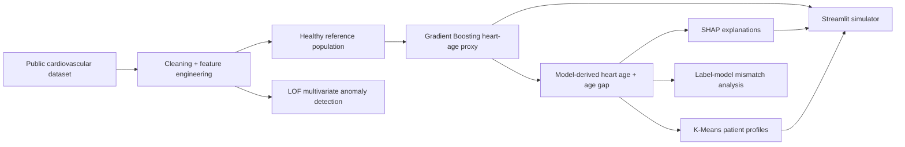

# Heart Age Engine

[](https://github.com/VT2305/heart-age-engine/actions/workflows/ci.yml)

**Explainable machine-learning project for model-derived heart-age estimation, anomaly detection, patient clustering, and interactive exploration.**

> Educational project only. The outputs are model-derived estimates from a public dataset and are **not** medical diagnoses or clinical recommendations.

## Why I built this

Most introductory ML projects stop after training a model and reporting a score. This project explores the rest of the workflow: cleaning noisy health data, defining a leakage-safe modelling problem, explaining predictions, finding unusual multivariate cases, grouping physiological profiles, and exposing the model through an interactive application.

This was originally developed as a **4-person NTU team project**. My main contribution was the anomaly-detection work using Local Outlier Factor (LOF), analysis of cases where dataset labels and model-derived heart-age estimates disagree, and the interactive simulator. This repository is a cleaned public version of the coursework project, organised for reproducibility and clearer engineering practice.

| Scope | Implementation |
|---|---|
| Dataset | 68,533 records in the cleaned coursework analysis |
| Anomaly detection | LOF across 11 health/lifestyle variables |
| Explainability | SHAP global + local feature contributions |
| Interactive layer | Streamlit simulator |

## Review this project in five minutes

1. Inspect the leakage guardrail in `tests/test_modeling.py`.
2. Follow the reusable pipeline in `src/heart_age_engine/pipeline.py`.
3. Read the modelling assumptions in [the model card](docs/MODEL_CARD.md).
4. Run the tests below, then train with the externally supplied dataset.

## System overview



## What the project demonstrates

- **Leakage-safe regression:** chronological age is the target and is deliberately excluded from the predictor set.
- **Explainability:** SHAP is used to inspect global and local feature contributions.
- **Anomaly detection:** Local Outlier Factor is applied after feature scaling to surface unusual multivariate profiles.
- **Unsupervised learning:** K-Means groups records into physiological profiles for exploratory analysis.
- **Interactive ML:** a Streamlit app lets users vary inputs and inspect the model-derived estimate and local feature contributions.
- **Reproducibility:** preprocessing, training, evaluation, and inference live in reusable modules rather than one monolithic notebook.
- **Engineering hygiene:** unit tests, linting, CI, dependency automation, and a model card are included.

## Original project result worth noting

The coursework analysis applied LOF across 11 health/lifestyle variables and flagged **3,427 records under a 5% contamination setting**. Because the contamination rate is specified by the analyst, this should be interpreted as a thresholded anomaly screen rather than evidence that exactly 5% of the population is clinically abnormal.

The public refactor intentionally regenerates downstream heart-age and mismatch results using a model that excludes chronological age from its predictors.

## Repository structure

```text
heart-age-engine/
├── app.py                         # Streamlit demo
├── src/heart_age_engine/          # Reusable ML package
│   ├── config.py
│   ├── data.py
│   ├── modeling.py
│   ├── anomaly_detection.py
│   ├── clustering.py
│   ├── explainability.py
│   └── pipeline.py
├── scripts/
│   ├── train.py                   # Train and save model bundle
│   └── evaluate.py                # Reproduce metrics and aggregate results
├── tests/                         # Unit tests
├── notebooks/01_analysis.ipynb   # Recruiter-friendly analysis walkthrough
├── docs/MODEL_CARD.md             # Intended use, limitations, methodology
├── data/README.md                 # Dataset setup instructions
├── .github/workflows/ci.yml       # Tests + lint on every push/PR
├── .github/dependabot.yml         # Automated dependency updates
├── pyproject.toml
└── requirements.txt
```

## Quick start

### 1. Create an environment

```bash
python -m venv .venv
```

Activate it, then install dependencies:

```bash
python -m pip install -e ".[dev]"
```

### 2. Get the dataset

Download the **Cardiovascular Disease Dataset** referenced in `data/README.md` and place either `cardio_train.csv` or `cardio_train.xlsx` inside `data/`.

### 3. Train the pipeline

```bash
python scripts/train.py --data data/cardio_train.xlsx
```

or:

```bash
python scripts/train.py --data data/cardio_train.csv
```

This creates a reproducible model bundle under `artifacts/` and writes training metrics to `results/`.

### 4. Run the evaluation

```bash
python scripts/evaluate.py --data data/cardio_train.xlsx
```

The script reports model quality, LOF anomaly counts, label/model mismatch counts, and cluster-level summaries.

### 5. Launch the interactive demo

```bash
streamlit run app.py
```

## Modelling notes

The heart-age component is an **educational proxy**, not a validated clinical biological-age measure. A Gradient Boosting Regressor is trained on records with `cardio == 0` to learn the relationship between health/lifestyle features and chronological age. Chronological age is then predicted from those features and compared with actual age to form a model-derived `age_gap`.

The predictor set is:

```text
gender, BMI, systolic BP, diastolic BP, pulse pressure,
cholesterol, glucose, smoking, alcohol, physical activity
```

Chronological age is **not** included in that predictor set.

## Anomaly detection

LOF operates on scaled values because its neighbourhood calculations are distance-based. The default public configuration is:

```text
n_neighbors = 20
contamination = 0.05
```

`contamination=0.05` is an analyst-selected threshold. It should not be interpreted as a prevalence estimate.

## Tests

```bash
pytest
```

The test suite includes a guardrail that fails if `age_years` is ever added to the heart-age predictor set.

## Data and privacy

The raw dataset is intentionally **not committed to this repository**. This keeps the repository lightweight and makes the external data source explicit. Generated model binaries and patient-level outputs are also excluded from version control.

## Limitations

- The source data is a public Kaggle dataset, not prospectively collected clinical data.
- Dataset labels and measurements can contain noise or entry errors.
- Heart age is a model-derived proxy and is not clinically validated.
- LOF identifies statistically unusual neighbourhoods; it does not diagnose disease.
- K-Means profiles are exploratory clusters, not medical phenotypes.
- Model performance and group-level findings can vary with preprocessing, split strategy, and hyperparameters.

See [`docs/MODEL_CARD.md`](docs/MODEL_CARD.md) for the full model documentation.

## Dataset reference

Svetlana Ulianova, **Cardiovascular Disease Dataset**, Kaggle:  
https://www.kaggle.com/datasets/sulianova/cardiovascular-disease-dataset

## Tech stack

`Python` · `scikit-learn` · `SHAP` · `pandas` · `NumPy` · `Streamlit` · `pytest` · `GitHub Actions`

---

Built as an educational ML project focused on **explainability, anomaly detection, reproducibility, and deployable analysis**.

## Verification status

On 25 October 2026, the public package passed all **4 unit tests** and `ruff check .` under Python 3.12. Full-dataset training was not rerun for this release because the dataset is supplied separately. Historical coursework counts above are not newly reproduced benchmark results.
